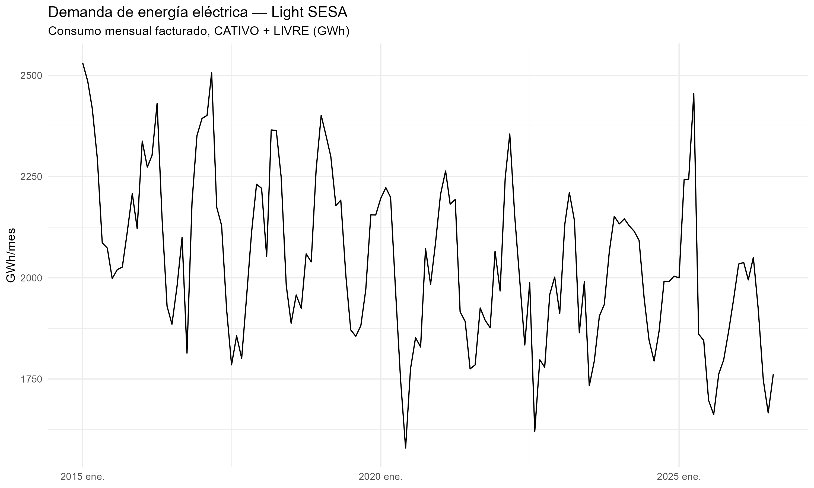
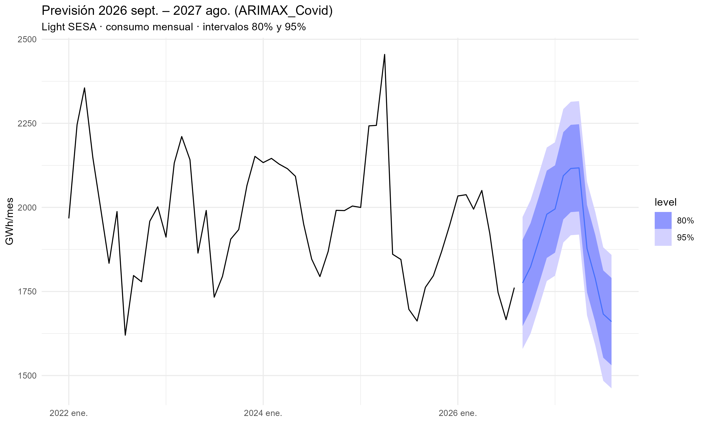

<!--
EXPORTAR:
  marp SLIDES_10MIN.md --pdf
  marp SLIDES_10MIN.md --pptx

TIEMPO TOTAL DE CONTENIDO: 8:20  (+ 4 traspasos de 10 s ≈ 9:00)
COLCHÓN: ~1:00

REPARTO
  A — láminas 1 a 4  (2:45)  contexto y método
  B — láminas 5 a 7  (2:30)  auditoría y combinación
  C — láminas 8 a 11 (3:05)  resultados y cierre

REGLA: una idea por lámina. Si una lámina tiene más de 25 palabras
además del título, está mal. Los números van grandes; el resto se dice.
-->

# Previsión de demanda eléctrica con intervención, bootstrap y validación móvil

### Light SESA · consumo mensual facturado · sep/2026 – ago/2027

**Pregunta de pesquisa**

> ¿Cuál será el consumo mensual facturado entre septiembre de 2026 y agosto de
> 2027, y **qué tan robusta** es esa previsión frente al choque de 2020 y a la
> incertidumbre sobre el modelo?

IND2616 · Análise de Séries Temporais · PUC-Rio · [A] · [B] · [C]

<!-- 0:15 — A
"Buenos días. La pregunta no es solo cuánto vamos a consumir: es cuánto, y con
qué confiabilidad. El trabajo no termina en un número; termina en un protocolo
que dice por qué ese número aguanta."
-->

---

## Un solo dato, tres problemas



| 140 meses | Estacionalidad | Deriva | Choque |
|---|---|---|---|
| ene/2015 – ago/2026 | **60 %** de la varianza | **≈ −24 GWh/año** | **−20 %** en jun/2020 |

**Consecuencia:** un promedio no sirve, un ARIMA sin estacionalidad no sirve, y
un modelo que ignore 2020 confunde el choque con la tendencia.

<!-- 0:50 — A
"140 observaciones, de enero 2015 a agosto 2026. Tres rasgos mandan: la
estacionalidad explica el 60 % de la variabilidad, con pico en marzo y valle en
agosto; hay una deriva suave de −24 GWh por año, que es la migración al mercado
libre; y hay un choque enorme y transitorio en 2020: el mínimo, 1.579 GWh en
junio, es 20 % de la base 2017-19."
-->

---

## El problema no es elegir un modelo

> Comparar ETS, SARIMA y un naive, y quedarse con el de menor error,
> **es una decisión condicional a un modelo que no sabemos si es el correcto.**

**Protocolo en tres pasos**

| | Paso | Pregunta que responde |
|---|---|---|
| **1** | Intervención (ARIMAX) | ¿cuánto pesa el choque y qué contamina? |
| **2** | Origen móvil | ¿la elección del modelo es estable? |
| **3** | BMC (bootstrap) | ¿qué pasa si el modelo correcto es otro? |

<!-- 0:40 — A
"Y acá está el punto de partida metodológico. Comparar modelos y elegir el de
menor error es una decisión condicional: supone que el modelo elegido es el
verdadero. Eso casi nunca se cumple. Por eso el trabajo no elige: audita. Tres
pasos: cuantificar el choque, verificar si la elección es estable, y combinar
tratando esa inestabilidad como un dato del problema."
-->

---

## Paso 1 · Intervención: el choque deja de ser anécdota

$$y_t = \beta_0 + \beta_1\,\text{covid}_t + \eta_t,\qquad \eta_t \sim \text{ARIMA}$$

**Pulso, no escalón** — abr–jun/2020 · jul ya en 96 % · oct en 104 % de la base

| Efecto estimado | Sin COVID | Con COVID |
|---|---:|---:|
| Coeficiente | — | **−315,7 GWh/mes** (ee 57,4 · t −5,5) |
| σ² residual | 12.474 | **10.811** |
| AICc | 1.443,6 | **1.425,4** |
| Ljung-Box (24) | p = 0,989 | **p = 0,960** |

<!-- 1:00 — A
"Una regresión dinámica no es una regresión con un ARIMA al lado: es una sola
verosimilitud, con errores ARIMA, para que los errores estándar sean válidos.
El choque entra como pulso de tres meses, y esa es una decisión con evidencia:
en julio ya estaba en 96 % de la base y en octubre por encima. El efecto es
−315,7 GWh por mes, con t de −5,5: nunca cruza cero. Y mirá el efecto sobre el
modelo: la varianza residual cae 13 %, el AICc mejora 18 puntos, y los residuos
siguen siendo ruido blanco. Eso es lo que el choque le hace al modelo."
-->

---

## Paso 2 · Auditoría: el ranking no sobrevive

**21 orígenes** (dic/2022 – ago/2024) × 12 meses = **252 puntos** por modelo

| Criterio | Ganador | MASE |
|---|---|---:|
| Test fijo (12 meses) | ARIMA | **0,473** |
| Origen móvil (21 ventanas) | ETS | **0,728** |

> El ARIMA gana el test y queda **último** en el origen móvil (0,836).

**No es un error: es inestabilidad del ranking.** Un solo corte = muestra de tamaño 1.

<!-- 0:55 — B
"Acá viene el hallazgo que motiva todo lo demás. Si evalúo en un solo bloque, el
ARIMA gana con 0,473. Pero si repito el ejercicio en 21 ventanas móviles, gana el
ETS con 0,728, y el ARIMA queda último, con 0,836. El ranking se invierte. No es
un error de cálculo: es que la elección depende del período. Elegir con un solo
corte es elegir con una muestra de tamaño uno."
-->

---

## Paso 3 · BMC: preguntar si la elección sobrevive

```
1. quitar el COVID        →  serie "sin pandemia"
2. STL periódico robusto  →  tendencia + estacionalidad + residuo
3. MBB (bloques de 2 meses, Hall–Horowitz–Jing)  →  residuo remuestreado
4. rearmar y reajustar    →  ETS · ARIMA · ARIMAX
5. peso = frecuencia con que cada modelo gana el AICc   (B = 200)
```

**No preguntamos cuál es el mejor modelo.**
Preguntamos si la elección **sobrevive a que la serie hubiera sido distinta.**

<!-- 0:55 — B
"Entonces cambiamos la pregunta. En vez de cuál es el mejor modelo, preguntamos:
si la serie hubiera sido un poco distinta, ¿habríamos elegido el mismo? Para eso
sacamos el COVID, descomponemos con STL para separar señal de ruido,
remuestreamos bloques del residuo para no romper la dependencia de corto plazo,
rearmamos la serie y reajustamos los tres modelos. Doscientas réplicas. El peso
de cada modelo es la frecuencia con que gana el AICc."
-->

---

## El resultado incómodo: pesos 0 · 0 · 1

| Modelo | Réplicas ganadas | Peso |
|---|---:|---:|
| ETS | 0 | 0,00 |
| ARIMA | 0 | 0,00 |
| **ARIMAX (intervención)** | **200 / 200** | **1,00** |

**El BMC colapsa al ARIMAX.** El bootstrap no diversifica acá: **audita**.

> Lectura honesta: la intervención **domina la selección** en todas las réplicas.
> El contraste correcto no es "el ensamble ganó", es el **promedio simple** (1/3).

<!-- 0:40 — B
"Y el resultado es incómodo, y lo decimos: cero, cero, uno. El ARIMAX gana las
doscientas réplicas. El ensamble colapsa. Pero el valor del ejercicio no era
diversificar: era demostrar que la selección no depende del remuestreo. El
contraste honesto es el promedio simple, que sí es un ensamble real. Los dos
aparecen en todas las tablas."
-->

---

## Evaluación fuera de muestra

| Modelo | RMSE | MASE | Winkler 95 | Cob. 80 |
|---|---:|---:|---:|---:|
| **ARIMA** | **71,2** | **0,473** | 458,1 | 91,7 % |
| ARIMAX / BMC | 76,9 | 0,520 | **408,7** | 91,7 % |
| Ensamble simple | 80,0 | 0,551 | 410,0 | 91,7 % |
| ETS | 98,3 | 0,689 | 439,2 | 91,7 % |

**ARIMA gana el punto. ARIMAX gana la distribución.**
El ARIMAX es el oficial: gana el rango medio de las cuatro evaluaciones.

<!-- 0:40 — C
"En el bloque de test, doce meses, el ARIMA gana en precisión puntual: 71 GWh de
RMSE y MASE 0,47. Pero el ARIMAX gana el Winkler, 409 contra 458: sus intervalos
son más angostos y cubren igual. La decisión no es quedarse con la métrica que
conviene: se promedian los rangos de MASE y Winkler, en el test y en el rolling,
y gana el ARIMAX. El modelo lo elige la tabla, no una línea escrita a mano."
-->

---

## La previsión



## **22.812 GWh** · IC 95 % ± 197 · mínimo 1.660 (ago/27) · máximo 2.118 (abr/27)

**22.588,5** (últimos 12 meses) **+ 223,2** (ajustes estacionales) **= 22.811,7**

> No es "promedio + tendencia": es **el año pasado corregido mes a mes**.

<!-- 0:55 — C
"Y acá está la cifra. 22.812 GWh para los doce meses, con un intervalo del 95 %
de más menos 197. Es importante entender de dónde sale: no es un promedio con
tendencia. Son los últimos doce meses observados, que suman 22.588, y doce
ajustes que el modelo pronostica, que suman 223. La corrección de cada mes viene
del error del mismo mes del año anterior; por eso el ajuste no es uniforme."
-->

---

## Robustez: la cifra no depende del modelo

| | Total 12 meses |
|---|---:|
| Mínimo (ETS) | 22.743,1 |
| ARIMA (mejor MASE) | 22.753,7 |
| **Oficial = máximo (ARIMAX)** | **22.811,7** |

**Rango 68,6 GWh = 0,30 %** · cinco modelos, mismo horizonte

> Lo que **no** es estable es el ranking. Lo que **sí** es estable es la cifra.

<!-- 0:35 — C
"Los cinco modelos, con el mismo horizonte, dan totales entre 22.743 y 22.812.
Sesenta y ocho GWh de diferencia, tres décimas por ciento. Esa es la robustez
más fuerte del trabajo: no depende de haber acertado un modelo. Lo que no es
estable es el ranking; la cifra sí."
-->

---

## Límites declarados y conclusión

| Límite | Evidencia |
|---|---|
| BMC degenerado: no diversifica | pesos 0/0/1 |
| Bootstrap de residuos: ignora incertidumbre de tendencia | STL fijo + MBB |
| El modelo **no se adapta a un quiebre** | Chow p = 0,052 · supF p = 0,058 · CUSUM p = 0,257 |

**Conclusión.** Para sep/2026–ago/2027: **22.812 GWh**, IC 95 % ±197, robusto
dentro de 0,30 %. El aporte no es el modelo: es el **protocolo** — cuantificar el
choque, auditar la estabilidad, combinar bajo incertidumbre.

**Trabajo inmediato:** regresión segmentada con quiebre en may/2023 (máximo del supF).

<!-- 0:55 — C
"Tres límites, dichos por nosotros antes de que los pregunten. El BMC degeneró: no
diversifica, y lo reportamos. El bootstrap es de residuos: no cubre la
incertidumbre de la tendencia. Y el modelo no se adapta a un quiebre: los tests
dan evidencia marginal, p alrededor de 0,05, y no lo usamos. Eso es lo próximo:
una regresión segmentada con quiebre en mayo 2023. Cierro: 22.812 GWh, más menos
197, robusto dentro de tres décimas. El aporte no es el modelo; es el protocolo.
Si preguntan por qué el ARIMAX y no el ARIMA: el ARIMA acierta mejor el número
(0,473 contra 0,520), pero el ARIMAX gana los dos Winkler y el rango medio."
-->

---

<!--
ANEXO — NO SE PRESENTA. Solo para preguntas.

A1. ESPECIFICACIÓN DE LOS MODELOS
  Serie completa, 140 observaciones:
  ARIMAX · MODELO OFICIAL
    LM con errores ARIMA(1,0,0)(1,1,1)[12]
    ar1 0,1530 (0,0897) · sar1 −0,1423 (0,1227) · sma1 −0,7877 (0,1204)
    covid −306,36 (60,72) · intercept −24,20 (3,09) · AICc 1.564,1 · σ² 9.998
  ARIMA(1,0,0)(1,1,1)[12] + drift · alternativo
    ar1 0,2959 (ee 0,0867) · sar1 −0,1041 (0,1310)
    sma1 −0,8014 (0,1399) · constant −18,7635 (3,1371)
    AICc 1.582,6 · σ² 11.653
  ETS(M,N,M): α 0,205 · γ ≈ 0,0001 · AICc 2.015,0
  Deriva implícita = c/[(1−φ)(1−Φ)] ≈ −24 a −25 GWh/año
  (el "constant" de report() está en escala ANUAL porque D = 1)

A2. DIAGNÓSTICO
  Ljung-Box lag 24, serie completa: ARIMA p 0,966 · ARIMAX p 0,981 · ETS p 0,762
  En entrenamiento: 0,989 · 0,960 · 0,758
  Guerrero λ 0,191 (se modela en niveles, justificado)
  KPSS 0,707 (p 0,0129) · ndiffs 1 · nsdiffs 1
  ACF de Δ12: lag 1 = +0,267 · lag 12 = −0,465

A3. POR QUÉ EL INTERVALO NO SE ABRE
  SMA(1) = −0,79 casi cancela la raíz unitaria estacional.
  Ancho 80 %: 257 → 260 GWh. Ancho 95 %: 392 → 397.
  Verificado con 2.000 simulaciones bootstrap. No es un bug de fable.

A4. COBERTURA EN ORIGEN MÓVIL
  ETS 78,6 / 93,3 · ARIMA 77,0 / 95,2 · ARIMAX 70,2 / 97,6
  → la banda del 80 % es optimista fuera de muestra; usar la del 95 %.

A5. QUIEBRES (strucchange, serie desestacionalizada)
  Chow dic/2021: 2,65 (p 0,052)
  supF Bai–Perron: 13,51 (p 0,058), máximo en may/2023
  OLS-CUSUM: 1,012 (p 0,257)
  Lectura: evidencia marginal; compatible con deriva gradual, no con escalón.

A6. SELECCIÓN Y OTRO MODELO OFICIAL
  Regla: promedio de rangos de MASE y Winkler, en test y rolling (1 = mejor).
  Rango medio: ARIMAX 2,25 · BMC 2,25 · ETS 3,25 · Ensamble 3,25 · ARIMA 4,00.
  El modelo sale de la tabla: modelo_final <- comparacion_modelos$.model[1]
  Override: modelo_final_forzado <- "ETS_Auto" (NULL = decide la tabla)
  Totales: 22.743,1 / 22.753,7 / 22.769,5 / 22.811,7 / 22.811,7
  Punto: ARIMA 0,4732 · ARIMAX 0,5203 · Ensamble 0,5513 · ETS 0,6885.
  Intervalo (Winkler): ARIMAX 408,7 · BMC 408,7 · Ensamble 410,0 · ETS 439,2 ·
  ARIMA 458,1. Los cinco totales difieren 0,30 %.
-->
